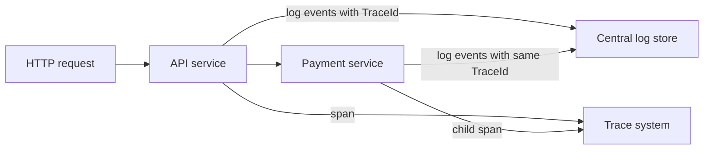

# 1. Logging Fundamentals

## What logging is

A log is a time-stamped record of an event observed by a running program. A useful event answers some of: what operation occurred, which entity or request it concerned, whether it succeeded, how long it took, and what failed. Logs are evidence about runtime behavior; they are most useful when designed before an incident.

For example, an expense API might record `Expense {ExpenseId} approved by User {UserId}`. That identifies a business-relevant action without dumping the complete request or database row.

## Why applications need logs

Logs help diagnose failures, understand application behavior, identify dependency problems, measure selected operations, and explain deployment behavior. In a production service, they provide operational context when a developer cannot attach a debugger or reproduce the exact environment.

### Logging and debugging

Debugging is an interactive technique: pause execution, inspect process state, and step through code. Logging is persistent instrumentation that can be reviewed after the process has continued or exited. Debugger output may be useful locally, but production diagnosis needs intentional logs routed to an accessible, retained destination.

Development logs can be more verbose. Production logs should retain operationally useful events while controlling volume, sensitive data, storage cost, and access.

### Centralized production logging

Applications commonly run across multiple instances, containers, workers, and services. A local file or one console stream cannot conveniently answer a cross-instance question. Route logs to a centralized platform that supports retention, access control, querying, alerting, and correlation. In container platforms, writing structured output to stdout/stderr is often collected by the hosting environment; file output is not automatically durable or centralized.

## Logging versus auditing

Operational logs explain system behavior and help troubleshoot. Audit records document security- or business-significant actions and may have stricter requirements for identity, completeness, tamper resistance, retention, and access. Ordinary diagnostic logs are not automatically a compliant audit trail. Design audit storage and controls explicitly where required.

## Logging versus distributed tracing

Logs are discrete events. Distributed traces represent a request's causal path across services using traces and spans, often with timing and parent-child relationships. Logs can include `TraceId` and `SpanId` so an operator can find related events, but logs alone do not create a distributed trace. Use OpenTelemetry-compatible instrumentation or the chosen tracing platform for end-to-end traces.

The trace links operations across services; log events add detailed application facts associated with that trace.

## Practical Web API scenarios

- Expense creation: Information on success with `ExpenseId` and actor identifier, subject to privacy policy.
- Approval denied by policy: Information or Warning depending on business meaning; avoid treating expected user outcomes as system failures.
- Payment gateway timeout: Warning for a retryable failure; Error when the operation ultimately fails, with exception and payment reference.
- Database unavailable: Error with the exception and operation context; do not log connection strings or SQL parameters that may contain personal data.
- Background job: include job name, job identifier, attempt, and outcome so work can be followed outside an HTTP request.

## Design useful events

An event should explain a meaningful state transition or failure, carry stable searchable properties, have an appropriate severity, and avoid duplicating noisy low-level framework events. A message like `Something went wrong` gives little diagnostic value. Prefer `Failed to persist expense {ExpenseId} after validation` and pass the exception when one exists.
