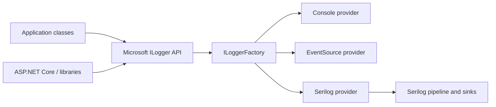

# 2. Microsoft Logging Abstraction

## The abstraction and its role

`Microsoft.Extensions.Logging` is the common .NET logging API used by the host, framework libraries, and application code. It lets code emit categorized events without depending on a particular destination or logging implementation. Providers connect that API to outputs or implementations such as the console, Application Insights, or Serilog.



The application and framework write through the abstraction. Each configured provider receives eligible events and routes them to its destination.

## `ILogger` and `ILogger<T>`

`ILogger` exposes methods for writing events and scopes. `ILogger<TCategoryName>` is a generic convenience that uses the fully qualified type name as its category. It is the preferred dependency for ordinary classes because each class naturally gets a useful category for filtering and searching.

```csharp
using Microsoft.Extensions.Logging;

public sealed class ExpenseService(ILogger<ExpenseService> logger)
{
    public void Approve(Guid expenseId, Guid userId)
    {
        logger.LogInformation(
            "Expense {ExpenseId} approved by User {UserId}", expenseId, userId);
    }
}
```

ASP.NET Core's dependency injection container supplies `ILogger<T>`; application code normally does not register each logger or choose a lifetime. The logging factory and providers are host-managed. Logger handles are designed for concurrent use in normal provider implementations; avoid building mutable per-request state into a shared logger.

### Common injection points

```csharp
public sealed class ExpensesController(ILogger<ExpensesController> logger) : ControllerBase
{
    // Log HTTP boundary events sparingly; middleware usually handles request completion.
}

public sealed class ExpenseService(ILogger<ExpenseService> logger)
{
    // Log meaningful business operation outcomes.
}

public sealed class ExpenseRepository(ILogger<ExpenseRepository> logger)
{
    // Log exceptional persistence failures when useful; avoid noisy SQL tracing by default.
}

public sealed class ApproveExpenseHandler(ILogger<ApproveExpenseHandler> logger)
{
    // A MediatR handler can use constructor injection like any other service.
}
```

These are examples of dependency injection, not a requirement to log at every layer. Choose the layer that has the best context and avoid duplicate events for one outcome.

## `ILogger<T>` versus `ILoggerFactory`

| Dependency | Use it when | Example |
|---|---|---|
| `ILogger<T>` | A class needs a logger with a stable category | Service, controller, handler |
| `ILogger` | A non-generic logger is passed into reusable helper code or generated logging methods | Shared component with category supplied elsewhere |
| `ILoggerFactory` | Code must create loggers dynamically for runtime-selected categories | A framework component managing named tenants or plug-ins |

`ILoggerFactory` is not a more powerful per-event logger; it is a factory for category-specific loggers and participates in configured provider management. Most app classes should not inject it just to write logs.

```mermaid
flowchart TD
  Host[Host configures providers] --> Factory[ILoggerFactory]
  Factory -->|CreateLogger\("Payments.Gateway"\)| Named[ILogger category]
  Factory -->|DI requests ILogger\<ExpenseService\>| Typed[ILogger\<ExpenseService\>]
  Named --> Events[Log events]
  Typed --> Events
```

## Categories and filtering

The category is metadata associated with each log event. For `ILogger<T>`, it is typically the type's full name; a factory can use an explicit category string. Providers and filters can apply different thresholds by category prefix, such as raising the threshold for framework namespaces while retaining application Information events.

## Provider integration

The abstraction can fan out an event to more than one provider. A provider is registered with logging infrastructure and adapts events to its destination or logging engine. Serilog's ASP.NET Core integration routes Microsoft `ILogger` events through Serilog, so app code can retain `ILogger<T>` while the Serilog pipeline handles output.

Microsoft references: [logging overview](https://learn.microsoft.com/en-us/dotnet/core/extensions/logging/overview), [provider guidance](https://learn.microsoft.com/en-us/dotnet/core/extensions/logging/providers), [`ILogger` API](https://learn.microsoft.com/en-us/dotnet/api/microsoft.extensions.logging.ilogger).
