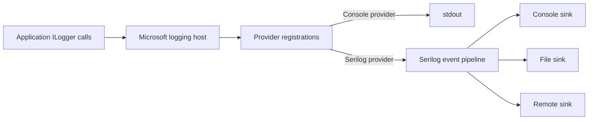
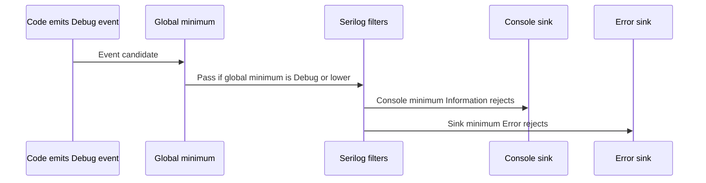

# 3. Logging Providers and Levels

## Providers and sinks

A Microsoft logging **provider** implements the bridge from `Microsoft.Extensions.Logging` to an output or logging engine. A Serilog **sink** is an output destination in the Serilog pipeline. When Serilog is integrated, the Serilog provider adapts Microsoft events into Serilog events; Serilog sinks then write them to console, files, or other systems.



Built-in providers commonly include Console, Debug, EventSource, and Windows EventLog; available defaults depend on the host and platform. Other Microsoft packages and third-party providers add destinations. Multiple providers may be active, so one event can be written to more than one destination. `ClearProviders()` removes registrations before adding a replacement set; use it deliberately because it also removes useful defaults.

## Levels and mapping

| Microsoft `LogLevel` | Serilog `LogEventLevel` | Typical intent |
|---|---|---|
| `Trace` | `Verbose` | Fine-grained execution details, usually disabled in production |
| `Debug` | `Debug` | Developer diagnostics useful during investigation |
| `Information` | `Information` | Normal meaningful application milestones and outcomes |
| `Warning` | `Warning` | Unexpected or degraded condition that is handled or recoverable |
| `Error` | `Error` | An operation failed and needs attention |
| `Critical` | `Fatal` | A severe failure threatens continued service or process operation |
| `None` | no direct Serilog event level | Microsoft filtering sentinel that disables logging at a threshold |

The names differ at the two ends: Microsoft `Trace` maps to Serilog `Verbose`; Microsoft `Critical` maps to Serilog `Fatal`. `None` is not an emitted severity. The integration performs the mapping.

## Filtering flow

Logging can be filtered at more than one point. With Serilog, the global minimum level is an early event-creation gate: events below it do not enter the pipeline. A sink's restricted level is destination-specific: an event may exist and be written to another sink while being skipped by this sink.



Example: global minimum `Debug`, console minimum `Information`, file sink minimum `Warning`. A Debug event passes the global gate but is written to neither sink. A Warning event is written to console and file. An Error event is written to both. If global minimum is `Warning`, Debug and Information events are discarded before any sink can receive them; lowering a sink's threshold cannot recover them.

Microsoft logging filters also apply before events reach providers. When using the Serilog integration, account for both the Microsoft provider-side filter configuration and Serilog's own global/override/sink filters. Avoid contradictory thresholds; make the intended path explicit and verify the effective configuration for the chosen integration.

## Serilog filtering example

```csharp
using Serilog;
using Serilog.Events;

var logger = new LoggerConfiguration()
    .MinimumLevel.Debug() // global event-creation gate
    .WriteTo.Console(restrictedToMinimumLevel: LogEventLevel.Information)
    .WriteTo.File("logs/app-.log",
        rollingInterval: RollingInterval.Day,
        restrictedToMinimumLevel: LogEventLevel.Warning)
    .CreateLogger();
```

For a standalone Serilog logger, `.MinimumLevel.Override("Microsoft", LogEventLevel.Warning)` raises the global minimum for matching source contexts. This does not itself define the sink destination threshold.

## Microsoft configuration example

```json
{
  "Logging": {
    "LogLevel": {
      "Default": "Information",
      "Microsoft": "Warning",
      "Microsoft.AspNetCore.Hosting": "Information"
    },
    "Console": {
      "LogLevel": {
        "Default": "Information"
      }
    }
  }
}
```

Provider-specific filters can narrow output for a provider; category filters apply to categories. Configuration keys and precedence can depend on host and provider. For Serilog configured through `Serilog.Settings.Configuration`, see chapter 5 rather than assuming the Microsoft `Logging` section configures Serilog's native pipeline.

Development can enable Debug selectively. Production commonly starts application logs at Information, raises noisy framework categories to Warning, and enables more verbose levels temporarily for a narrowly scoped investigation. Keep configuration controllable and review storage impact.

Microsoft details: [providers](https://learn.microsoft.com/en-us/dotnet/core/extensions/logging/providers), [ASP.NET Core logging](https://learn.microsoft.com/en-us/aspnet/core/fundamentals/logging/).
