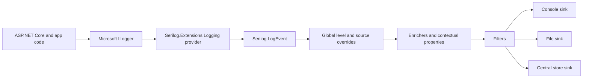

# 4. Serilog Architecture

## What Serilog provides

Serilog is a .NET logging implementation built around structured log events. It provides logger configuration, event levels and properties, enrichment, filtering, and a broad ecosystem of sinks. It solves the problem of turning application diagnostics into consistent, searchable events and routing them to suitable destinations.

## Microsoft and Serilog logger types

| Type | Namespace | Responsibility | Team default |
|---|---|---|---|
| `Microsoft.Extensions.Logging.ILogger<T>` | `Microsoft.Extensions.Logging` | App-facing abstraction used by ASP.NET Core DI and framework components | Inject in application classes |
| `Serilog.ILogger` | `Serilog` | Serilog-specific logger with Serilog APIs and behavior | Use in bootstrap/infrastructure or when Serilog-specific features are needed |

The two interfaces have the same short type name but are different types. Serilog integration can route `ILogger<T>` calls through the configured Serilog pipeline. Keeping application services on Microsoft's interface reduces coupling to a particular logging implementation.

## Event pipeline



An app call provides a level, template, values, optional exception, and category. The integration maps this into a Serilog event. The configured pipeline filters, enriches, and dispatches it to sinks. Exact ordering of some sink-local operations can vary with nested/logger configurations, so documentation for the selected sink and filter should be consulted when behavior depends on order.

## Main components

- **`LoggerConfiguration`**: fluent builder for minimum levels, overrides, enrichers, filters, and sinks.
- **Logger**: configured object that accepts events; usually created once at process startup.
- **Log event**: timestamp, level, message template, property values, optional exception, and other metadata.
- **Enricher**: adds properties such as service name or request context.
- **Filter**: decides whether an event should proceed.
- **Sink**: serializes or transmits an event to a destination.

```csharp
Log.Logger = new LoggerConfiguration()
    .MinimumLevel.Information()
    .Enrich.FromLogContext()
    .Enrich.WithProperty("Application", "ExpenseApi")
    .WriteTo.Console()
    .CreateLogger();
```

Serilog is not itself a centralized logging service. It produces and routes events; the operational platform, sink, collector, and retention setup determine storage, querying, access, and alerting.
