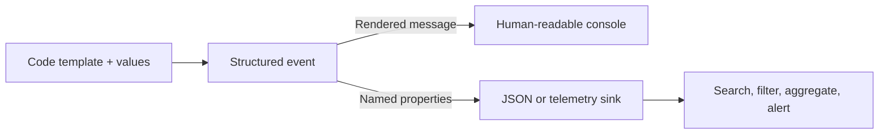

# 7. Structured Logging

## Why structure matters

Plain text logs are easy to read but difficult to query reliably. Structured logging records named values separately from the rendered message. A centralized system can search `ExpenseId = ...`, group payment failures by provider, or graph retry counts without guessing how to parse sentence text.



The event remains structured even if a text sink renders it as a sentence. Sink formatting affects representation, not the original intent of the event.

## Message templates

Use named placeholders with matching semantic names:

```csharp
logger.LogInformation(
    "Expense {ExpenseId} approved by User {UserId}", expenseId, userId);
```

The names become property keys. Positional placeholders such as `{0}` are less descriptive. Keep property names and template wording stable so dashboards and queries remain useful over time.

## Destructuring and data scope

Serilog supports destructuring complex objects (commonly using `{@Object}`) into properties. Do this only for small, intentionally safe objects. Do not serialize whole HTTP requests, ORM entities, payment objects, or arbitrary DTOs: they may be huge, include secrets or personal information, create schema churn, and increase cost. Prefer a small explicit set of identifiers and outcome fields.

```csharp
logger.LogInformation("Expense {ExpenseId} submitted with {LineCount} lines",
    expense.Id, expense.Lines.Count);
```

In Serilog direct APIs, `{@Expense}` requests structured destructuring and `$` can request stringification. These are Serilog message-template conventions; avoid assuming every third-party provider renders every destructuring policy identically.

## Query-oriented event design

Prefer properties that answer operational questions: `PaymentId`, `Provider`, `Attempt`, `ElapsedMs`, `StatusCode`, and `TraceId`. Use consistent types (GUIDs remain GUID-like values, durations numeric), avoid putting dynamic identifiers in the message template text, and do not use high-cardinality values as metric labels unless the platform supports the cost.

### Bad and better

```csharp
// Bad: difficult to query and may expose far too much.
logger.LogInformation($"Payment {payment} failed for {customerEmail}");

// Better: selected safe facts are searchable.
logger.LogWarning(exception,
    "Payment {PaymentId} failed with provider {Provider}", payment.Id, providerName);
```

The second example retains the exception separately and avoids logging the customer email or full payment object.

Reference: [Serilog structured data](https://github.com/serilog/serilog/wiki/Structured-Data) and [Microsoft logging overview](https://learn.microsoft.com/en-us/dotnet/core/extensions/logging/overview).
