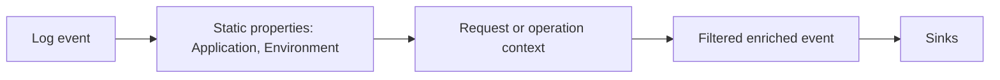
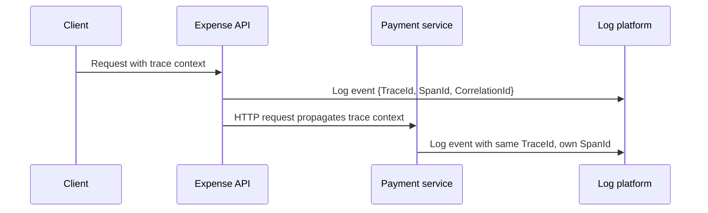

# 8. Enrichers and Context

## Enrichment

An enricher adds stable or contextual properties to events as they pass through a Serilog pipeline. Useful examples include service name, environment, machine name, process ID, and request identifiers. Enrichment avoids repeating the same property in every call and improves filtering across services.



Configure `Enrich.FromLogContext()` if events should carry properties pushed through Serilog `LogContext` or compatible scopes. A typical logger may also add `Application` and environment properties from trusted host configuration.

## `LogContext` and Microsoft scopes

`LogContext.PushProperty()` adds a property to events emitted inside a lexical scope. Always dispose scope tokens, preferably with `using`, and configure `.Enrich.FromLogContext()` for those properties to flow through Serilog. Microsoft `ILogger.BeginScope()` is the abstraction-level equivalent for contextual logging. Serilog integration supports dictionary-shaped scopes as structured properties when configured to read log context.

```csharp
using (logger.BeginScope(new Dictionary<string, object>
{
    ["ExpenseId"] = expenseId,
    ["Operation"] = "ApproveExpense"
}))
{
    logger.LogInformation("Loading approval rules");
    logger.LogInformation("Approval rules loaded");
}
```

```csharp
using (LogContext.PushProperty("ExpenseId", expenseId))
using (LogContext.PushProperty("Operation", "ApproveExpense"))
{
    Log.Information("Loading approval rules");
}
```

Do not rely on ambient context crossing process boundaries automatically. Propagate identifiers explicitly through HTTP headers/messages or tracing instrumentation.

## Correlation and tracing identifiers



- **TraceId** identifies the distributed trace; use tracing/OpenTelemetry propagation where possible.
- **SpanId** identifies a specific operation within that trace.
- **CorrelationId** is an application or business correlation key when one is needed. Define its creation, validation, and propagation contract.
- **ThreadId** identifies the managed thread that emitted an event, not the logical request or operation.

In asynchronous code, execution may resume on a different thread after `await`; thread-pool reuse means many operations share threads over time. Therefore ThreadId is supplementary diagnostic data and should not be used to correlate a request. Prefer TraceId, SpanId, or an explicit CorrelationId.

The optional `Serilog.Enrichers.Thread` NuGet package adds ThreadId with `.Enrich.WithThreadId()`. Confirm package compatibility and whether thread data helps the target workload before enabling it globally.

Reference: [Serilog enrichment](https://github.com/serilog/serilog/wiki/Enrichment), [ASP.NET Core Serilog integration](https://github.com/serilog/serilog-aspnetcore).
