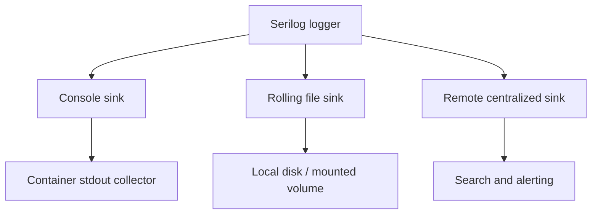

# 9. Serilog Sinks

## What a sink does

A sink is a Serilog destination that receives eligible events and writes or transmits them. Typical choices include console output, rolling local files, a search platform, a telemetry service, or a queue. Sinks are generally separate NuGet packages; select and maintain them as explicit dependencies.



## Destination tradeoffs

| Destination | Useful for | Operational considerations |
|---|---|---|
| Console | Local development and container output collection | Host must collect and retain stdout/stderr |
| File | Local diagnostics or environments requiring files | Rotation, retention, disk quotas, permissions, and volume persistence |
| Central telemetry/log system | Production search, dashboards, alerting, cross-instance correlation | Network failures, ingestion limits, cost, credentials, access and retention |
| Queue/collector | Decoupling application writes from downstream ingestion | Backpressure, durability, retries, queue capacity and delivery semantics |

## File sink example

```csharp
new LoggerConfiguration()
    .WriteTo.File("logs/app-.log",
        rollingInterval: RollingInterval.Day,
        retainedFileCountLimit: 14)
    .CreateLogger();
```

Set explicit retention and size policies appropriate to the environment. A local file sink by itself does not provide centralized search, durable storage, or backups. Ensure logging failures do not create an uncontrolled disk-growth incident.

## Multiple sinks and sink filtering

One logger can dispatch events to several sinks. A destination can have its own minimum level or filter, for example Debug to a short-lived local diagnostic file and Information+ to console. The global minimum still controls whether an event enters the pipeline at all. See the filtering examples in [chapter 3](03-logging-providers-and-levels.md).

```csharp
new LoggerConfiguration()
    .MinimumLevel.Debug()
    .WriteTo.Console(restrictedToMinimumLevel: LogEventLevel.Information)
    .WriteTo.File("logs/errors-.log",
        restrictedToMinimumLevel: LogEventLevel.Error,
        rollingInterval: RollingInterval.Day)
    .CreateLogger();
```

## Reliability

Network sinks may buffer, retry, or fail depending on their implementation and configuration. Understand the sink's behavior under outage, queue saturation, shutdown, and throttling. Consider asynchronous wrappers only after measuring; they introduce buffering and delivery tradeoffs. Flush on orderly shutdown, monitor dropped-event diagnostics where available, and avoid allowing logging outages to conceal application health problems.

Find maintained sink packages and destination-specific details in [Serilog provided sinks](https://github.com/serilog/serilog/wiki/Provided-Sinks). That list is ecosystem information, not a guarantee that every listed package is maintained or appropriate; review package ownership, compatibility, and security before adoption.
