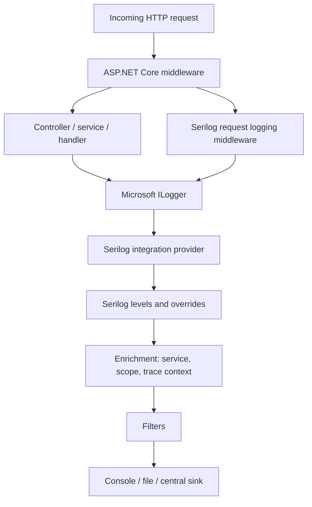

# 10. ASP.NET Core Implementation

## End-to-end path



The host creates loggers and providers. Application code injects `ILogger<T>`. The Serilog integration routes those events through a Serilog logger. Request middleware can emit a concise completion event. Sinks determine where events go.

## Suggested setup

Install `Serilog.AspNetCore` and a sink package compatible with the target framework. A code-based setup:

```csharp
using Serilog;

Log.Logger = new LoggerConfiguration()
    .MinimumLevel.Information()
    .Enrich.FromLogContext()
    .Enrich.WithProperty("Application", "ExpenseApi")
    .WriteTo.Console()
    .CreateLogger();

try
{
    var builder = WebApplication.CreateBuilder(args);
    builder.Services.AddSerilog();
    builder.Services.AddControllers();

    var app = builder.Build();
    app.UseSerilogRequestLogging();
    app.MapControllers();
    app.Run();
}
catch (Exception exception)
{
    Log.Fatal(exception, "Application stopped unexpectedly");
    throw;
}
finally
{
    await Log.CloseAndFlushAsync();
}
```

The integration's versioned README is authoritative for overloads and lifecycle behavior. Add `UseSerilogRequestLogging()` before the endpoints whose execution should be measured; middleware order determines what is included. It emits a concise request completion event with method, path, status, and elapsed time, and can be customized. Be careful about sensitive or high-cardinality paths and query strings.

## Inject the Microsoft abstraction

```csharp
public sealed class ExpensesController(
    IExpenseService expenses,
    ILogger<ExpensesController> logger) : ControllerBase
{
    [HttpPost("{id:guid}/approve")]
    public async Task<IActionResult> Approve(Guid id, CancellationToken cancellationToken)
    {
        logger.LogInformation("Approval requested for Expense {ExpenseId}", id);
        await expenses.ApproveAsync(id, cancellationToken);
        return NoContent();
    }
}
```

Often the service layer has better outcome context than the controller. Avoid logging the same successful operation at every layer.

## Development and production

Development: use readable console output and selectively enable Debug. Production: emit structured console output for the platform collector or a centrally managed sink, reduce framework noise with category overrides, define retention and access policies, and protect secrets. Do not assume ASP.NET Core includes a general file provider; use an explicit sink/provider when file output is required.

## Configuration caveat

The Microsoft `Logging` section controls Microsoft logging filters/providers. Serilog's native configuration is typically under `Serilog` when `Serilog.Settings.Configuration` is used. With Serilog replacing the default providers, configure one clear source of truth for thresholds, and verify which filtering layer is active in the exact integration version.

References: [Serilog.AspNetCore README](https://github.com/serilog/serilog-aspnetcore), [Microsoft ASP.NET Core logging](https://learn.microsoft.com/en-us/aspnet/core/fundamentals/logging/).
